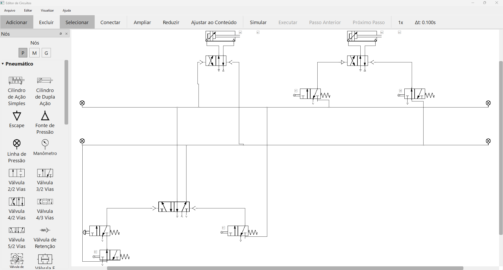

# Simulador Didático de Sistemas Fluidomecânicos

Editor e simulador de circuitos hidráulicos, pneumáticos e eletropneumáticos
para ensino. Monte o circuito arrastando componentes, simule em tempo real e
acompanhe pressões, vazões e o movimento dos atuadores.



## Funcionalidades

- **Editor visual**: paleta de componentes, conexões com roteamento
  ortogonal, rotação, copiar/colar, desfazer/refazer.
- **Simulação**: execução contínua ou passo a passo (avançar/voltar no tempo),
  com o estado do circuito refletido no diagrama.
- **Componentes**: bombas, motores, cilindros, válvulas direcionais, de
  retenção, de alívio, redutoras de pressão, controladoras de vazão e
  lógicas, acumuladores, manômetros, reservatórios, além de fontes, botões,
  relés e bobinas para comandos elétricos.
- **Geração automática de circuitos** a partir de uma sequência de movimentos
  (ex.: `A+ B+ A- B-`, ou `(A+ B+) A- B-` para movimentos simultâneos), pelos métodos cascata e passo a passo (pneumático e
  elétrico).
- **Defeitos simuláveis** em componentes (vazamentos, perda de desempenho
  etc.), para exercícios de diagnóstico.
- **Relatório** da simulação com gráficos das grandezas registradas.
- Interface em **português e inglês**, com temas claro e escuro.

## Download

A forma mais simples de usar é baixar o executável pronto, sem precisar
instalar Python:

**[Baixar a versão mais recente](https://github.com/Felipe-Feijo/tcc-circuitos/releases/latest)**

Baixe o `CircuitEditor.exe` e execute. Disponível para Windows.

> Na primeira execução o Windows SmartScreen ou o antivírus podem exibir um
> aviso, pois o executável não é assinado digitalmente. Ele também demora
> alguns segundos para abrir, porque se descompacta numa pasta temporária.

## Executando a partir do código-fonte

Requer Python 3.14.

```bash
git clone https://github.com/Felipe-Feijo/tcc-circuitos.git
cd tcc-circuitos
python -m venv venv
venv\Scripts\activate
pip install -r requirements.txt
python app.py
```

## Desenvolvimento

### Ambiente de desenvolvimento

Além das dependências da aplicação, instale as ferramentas de desenvolvimento
(pytest, PyInstaller, pip-tools e PySide6, usado para compilar as traduções):

```bash
pip install -r requirements-dev.txt
```

### Dependências

As dependências são gerenciadas com [pip-tools](https://github.com/jazzband/pip-tools):

- `requirements.in`: dependências diretas da aplicação.
- `requirements-dev.in`: ferramentas de desenvolvimento (inclui o `requirements.in`).
- `requirements.txt` / `requirements-dev.txt`: versões travadas, geradas
  automaticamente. Não edite à mão.

Para adicionar ou atualizar uma dependência, edite o `.in` correspondente e
recompile:

```bash
pip-compile requirements.in
pip-compile requirements-dev.in
pip install -r requirements-dev.txt
```

### Testes

```bash
pytest tests
```

### Traduções

Os textos da interface estão em inglês no código e são traduzidos via Qt
Linguist. Os catálogos ficam em `resources/i18n/`. Depois de editar um `.ts`,
compile os `.qm`:

```bash
python scripts/compile_translations.py
```

### Gerando o executável

O executável é gerado com [PyInstaller](https://pyinstaller.org/). Há duas
configurações:

| Arquivo | Resultado |
|---|---|
| `CircuitEditor-onefile.spec` | Um único `dist/CircuitEditor.exe`, mais fácil de distribuir. É o publicado em Releases. |
| `CircuitEditor.spec` | Uma pasta `dist/CircuitEditor/` com o executável e suas dependências. Abre mais rápido. |

Com o ambiente virtual ativo e as dependências de desenvolvimento instaladas,
compile as traduções e gere o executável:

```bash
python scripts/compile_translations.py
pyinstaller --clean CircuitEditor-onefile.spec
```

Em versões empacotadas sem console, erros são gravados em
`circuit_editor.log`, ao lado do executável.

## Arquitetura

O código é organizado em camadas: interface (`main_window/`), editor
(`editor/`, `graphics/`), persistência (`persistence/`), simulação
(`simulation/`) e geração automática de circuitos (`circuit_generator/`).
A descrição completa está em
[system_architecture_overview.md](system_architecture_overview.md), e os
diagramas UML em [docs/diagramas/](docs/diagramas/).

## Sobre

Este simulador foi desenvolvido como Trabalho de Conclusão de Curso em
Engenharia Mecatrônica na Escola Politécnica da Universidade de São Paulo
(Poli-USP), Departamento de Engenharia Mecatrônica e de Sistemas Mecânicos (PMR).

- **Autor:** Felipe Prandini de Mattos Feijó
- **Orientador:** Prof. Dr. Emílio Carlos Nelli Silva
- **Trabalho:** *Simulador Didático de Sistemas Fluidomecânicos* (2026)

## Licença

Copyright (C) 2026 Felipe Prandini de Mattos Feijó

Distribuído sob a licença [GNU General Public License v3.0](LICENSE) ou
qualquer versão posterior (GPL-3.0-or-later).
